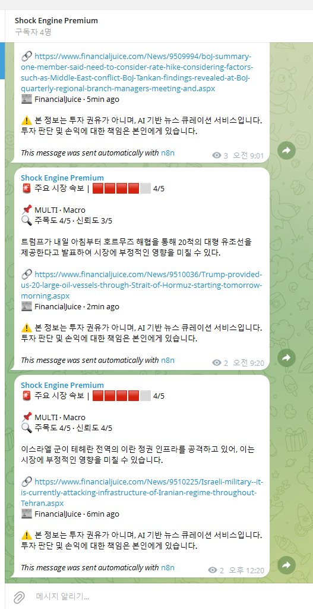
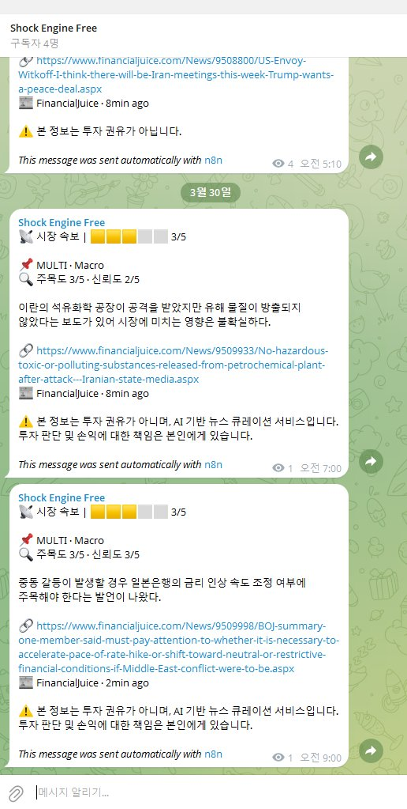

# Shock Engine — AI 기반 실시간 금융 뉴스 자동 분류 및 텔레그램 배포 시스템

> **n8n + GPT-4o-mini + Yahoo Finance API**로 구축한 실시간 금융 뉴스 모니터링 자동화 파이프라인.
> 뉴스 수집 → AI 충격도 분석 → 티어별 자동 배포 → 가격 추적까지 **완전 자동화**.


---

## 시스템 개요

Shock Engine은 미국 주식 시장에 영향을 미치는 뉴스를 실시간으로 수집·분석하여,
충격도에 따라 **Premium**(고충격)과 **Free**(중충격) 채널로 자동 분류·배포하는 시스템입니다.

**핵심 흐름:**

```
[8개 RSS + FinancialJuice]
        ↓ 10분 주기 자동 수집
[키워드 필터 v23] — 기업/매크로/지정학 3경로 분류
        ↓
[Google Sheets 중복 체크]
        ↓
[GPT-4o-mini 충격 분석] — shock_score, confidence, direction, thesis
        ↓
[라우팅 엔진] — score ≥ 4 → Premium / score 3 + 주요 이벤트 → Free
        ↓                              ↓
[Yahoo Finance 진입가 추출]    [텔레그램 자동 포스팅]
        ↓
[60분 후 종료가 추적 + 수익률 계산]
```

---

## 텔레그램 채널 실제 운영 화면

### Premium 채널 (shock_score ≥ 4)


### Free 채널 (shock_score 3 + 주요 이벤트)


---

## 기술 스택

| 구분 | 기술 |
|------|------|
| 워크플로우 엔진 | n8n (셀프 호스팅) |
| AI 분석 | OpenAI GPT-4o-mini API |
| 뉴스 소스 | RSS (Benzinga, CNBC, MarketWatch, NYT, Yahoo, Bloomberg, SeekingAlpha) + FinancialJuice |
| 가격 데이터 | Yahoo Finance API (v8) |
| 데이터 저장 | Google Sheets (중복 체크 + 성과 추적 DB) |
| 알림 채널 | Telegram Bot API (Premium / Free 2채널) |
| 스크립팅 | JavaScript (n8n Code 노드) |

---

## 워크플로우 상세 (49개 노드)

### 1. 뉴스 수집 (10분 주기)
- 8개 RSS 피드 + FinancialJuice 실시간 수집
- `Parse RSS v14`: XML 파싱, CDATA 처리, 노이즈 키워드 필터링, 24시간 이내 기사만 통과

### 2. 키워드 필터링 (`Keyword Filter v23`)
- **3경로 분류**: 지정학 충격 / 매크로 이벤트 / 기업 이벤트
- Reaction 기사 자동 차단 (주가 반응 해설 ≠ 이벤트)
- 크립토 노이즈 차단, Microsoft Outlook 오탐 방지
- 최소 길이 게이트: 매크로 소스 10자 / 일반 40자

### 3. 중복 제거
- Google Sheets DB 기반 URL 정규화 비교
- 루프 내 `.item.json` 참조로 정확한 현재 기사 비교

### 4. AI 충격도 분석 (`GPT Shock Detection`)
- GPT-4o-mini에 뉴스 제목 + 본문 스니펫 전송
- 응답 필드: `shock_score`(1-5), `confidence`(1-5), `direction`, `event_type`, `ticker`, `thesis`(한국어)

### 5. 분석 결과 파싱 (`Parse GPT + Route Decision v9`)
- 한글 가드: 영어 thesis 자동 차단
- Direction 정규화: Bullish/Bearish/Neutral
- event_type 정규화: 부분 매칭으로 GPT 변형 출력 커버
- shock_score 파싱 강화: "4/5", "4점", "4.5" 등 모두 처리
- 티커 정규화: `$` 제거, 하이픈→점 변환 (BRK-B → BRK.B)

### 6. 라우팅 엔진
| 조건 | 라우팅 |
|------|--------|
| shock_score ≥ 4 | **Premium** |
| shock_score = 3 + 주요 이벤트 유형 | **Free** |
| shock_score = 3 + Analyst + 빅테크/반도체 화이트리스트 | **Free** (v9 추가) |
| 기타 | Discard |

### 7. 가격 추적 파이프라인
- **진입가**: 포스팅 시점 Yahoo Finance 실시간 가격
- **종료가**: 60분 후 자동 추적
- **수익률**: `change_pct = (exit - entry) / entry × 100`

---

## 개발 방식

> **이 프로젝트의 모든 코드는 AI 도구를 활용하여 작성되었습니다.**

| AI 도구 | 활용 내역 |
|---------|----------|
| ChatGPT | 초기 아키텍처 설계, RSS 파싱 로직, GPT 프롬프트 설계 |
| OpenAI Codex | 코드 노드 최적화, 버그 수정, 오탐 방지 로직 |
| Claude | 구조 검토, 엣지케이스 발견, 리팩토링 제안 |

**제가 담당한 영역:**
- 전체 시스템 아키텍처 설계 (어떤 뉴스를, 어떤 기준으로, 어디에 보낼지)
- GPT 프롬프트 엔지니어링 (shock_score 기준, 한국어 thesis 요구사항)
- Premium/Free 티어 라우팅 기준 설계 (수익화 모델)
- 39번의 반복 개선 (에러 → 원인 분석 → AI에 수정 지시 → 테스트 → 배포)
- 실제 텔레그램 채널 운영 및 모니터링

---

## 버전 히스토리 (주요)

| 버전 | 변경사항 |
|------|---------|
| v1~v9 | 기본 RSS 수집 + GPT 분석 파이프라인 구축 |
| v10~v19 | 기업 이벤트 필터 정교화, Reaction 기사 차단 |
| v20 | FinancialJuice 매크로 소스 통합 |
| v21~v23 | 매크로 3중 게이트 (Entity + Action + Context), 오탐 방지 |
| v30+ | Premium/Free 티어 라우팅, 가격 추적 파이프라인 |
| v39 | Analyst 화이트리스트, thesis 접두어 후처리, 추적성 필드 |

---

## 사용 방법

### 사전 요구사항
- n8n 인스턴스 (셀프 호스팅 또는 n8n Cloud)
- OpenAI API 키 (GPT-4o-mini)
- Telegram Bot 토큰 + 채널 ID
- Google Sheets API 크레덴셜

### 설치
1. `workflow.json`을 n8n에 Import
2. 각 크레덴셜 노드에 본인의 API 키 / 토큰 설정
3. Google Sheets에 중복 체크용 시트 생성
4. 텔레그램 봇을 Premium / Free 채널에 추가
5. 워크플로우 활성화

> ⚠️ `workflow.json`의 크레덴셜은 모두 `YOUR_*` 플레이스홀더로 대체되어 있습니다.

---

## 라이선스

MIT License

---

## 만든 사람

**범솔** — IT 운영 자동화 엔지니어 (경력 7년+)

- GitHub: [@lifeispain1124](https://github.com/lifeispain1124)
- Email: beomsol1124@gmail.com
- 주요 기술: n8n, PowerShell, AutoHotkey v2, VMware, M365, AI 프롬프트 엔지니어링
